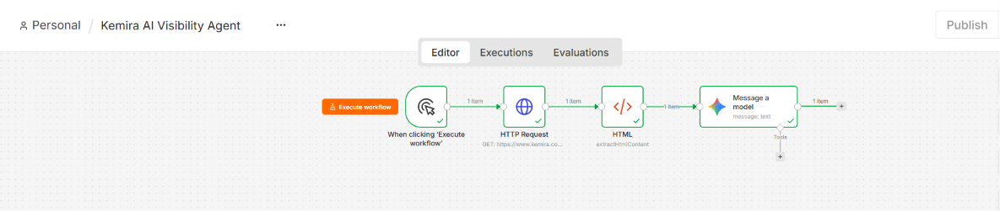
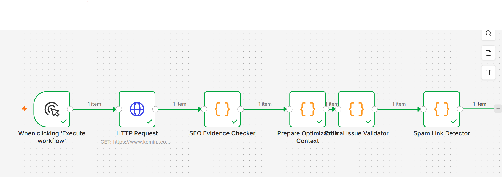
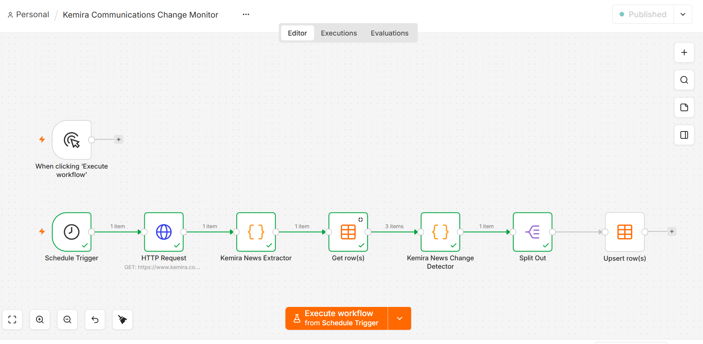

# Kemira — Low-Cost Communications & SEO/GEO Automation Projects

### Practical automation experiments using n8n, JavaScript and AI-assisted content analysis

## About This Portfolio

I built these independent projects to explore how simple, affordable automation can help communications teams manage repetitive digital tasks.

My main goal was to learn by building something practical. Instead of starting with expensive software or a complex AI system, I used n8n, public webpage content, JavaScript and a language model where it was useful.

The projects focus on three everyday challenges:

- Reviewing website content for possible SEO and GEO improvements.
- Making basic website checks easier to repeat.
- Monitoring company news without manually checking the same page every day.

These are working prototypes, not finished enterprise products. They show how relatively small workflows can support communications work while keeping the tools and processes understandable.

---

## 1. Kemira AI Visibility Agent

**AI-assisted website content review**



### Why I built it

Company websites contain a lot of useful information, but reviewing content regularly takes time.

I wanted to see whether a simple workflow could collect the main content of a webpage and help identify areas that might be clearer for both search engines and AI-powered search experiences.

### How it works

The workflow uses n8n to:

1. Retrieve the public Kemira company webpage.
2. Extract the main webpage content.
3. Send a limited portion of that content to a language model.
4. Generate three content improvement suggestions with supporting evidence.

**Page reviewed:** https://www.kemira.com/company/

The analysis was limited to the first 3,000 characters of the extracted main content.

### What this could help with

For a communications team, this kind of workflow could provide a quick first review before a more detailed content audit.

It may help identify unclear explanations, missing context or opportunities to make important company information easier to understand.

The AI output is a starting point for human review, not an automatic decision about what should be published.

### What I learned

I learned how to connect webpage extraction with a language model, structure an audit prompt and ask for recommendations supported by the actual source content.

I also learned why AI-generated suggestions need to be checked against the original webpage.

---

## 2. Kemira Low-Cost SEO/GEO Optimizer

**Simple, repeatable website checks**



### Why I built it

Not every website check needs an expensive SEO platform.

I wanted to experiment with a lightweight approach that could flag selected issues and give someone a practical starting point for reviewing a page.

### How it works

The prototype retrieves public webpage information and performs selected rule-based checks.

During testing, it flagged a potential missing meta description and produced other observations for review.

These findings were treated as possible issues, not confirmed technical defects. For example, an element missing from raw HTML does not necessarily mean it is missing from the rendered webpage.

### What this could help with

A small communications team could use a workflow like this as an initial checklist when reviewing or updating important website pages.

It could help make routine checks more consistent and reduce the need to repeat every basic step manually.

A full technical SEO audit would still require additional tools and verification.

### What I learned

This project helped me understand the difference between identifying a possible issue and proving that an issue exists.

It also showed me that straightforward code-based checks can be useful without adding AI to every step.

---

## 3. Kemira Communications Change Monitor

**Monitoring official company news and avoiding duplicate records**



### Why I built it

Communications teams often need to keep track of new company announcements.

Checking a webpage manually every day is a small task, but it becomes repetitive. I wanted to build a workflow that remembers what it has already seen and identifies newly discovered releases.

### How it works

The n8n workflow:

1. Retrieves Kemira's public news webpage.
2. Extracts the latest displayed releases.
3. Reads previously saved release URLs from an n8n Data Table.
4. Compares current releases with the stored history.
5. Identifies releases that have not been saved before.
6. Stores their URLs, titles, dates and release types.

**Source:** https://www.kemira.com/news-and-stories/

**Storage:** n8n Data Tables

**Main tools:** n8n, HTTP Request, JavaScript, Split Out and Data Tables

### What I tested

The workflow successfully extracted three official releases and stored their details.

When I ran the workflow again, the change detector returned:

```json
{
  "status": "no_change",
  "newCount": 0,
  "monitoredCount": 3,
  "newNews": []
}
```

This showed that the workflow recognized the previously stored releases instead of treating them as new.

The workflow has a daily schedule configured, although unattended daily production execution has not yet been independently verified.

### What this could help with

For a communications team, this approach could support routine monitoring of public announcements.

Instead of repeatedly reviewing the same items, a team could focus on releases that have not appeared in its saved history.

The same general idea could be extended to other public company pages, with suitable adjustments to extraction and error handling.

### What I learned

This was the most useful debugging exercise in the portfolio.

My first approach to remembering previous releases was not reliable enough for the tests. I replaced it with persistent storage using n8n Data Tables.

I also fixed an issue where incorrect field mappings created empty records.

The final repeat-run test confirmed that the saved release URLs were being used for comparison.

---

## Why I Chose a Low-Cost Approach

I wanted these projects to be realistic for teams that do not have a large automation budget.

The approach was deliberately simple:

- Use public information instead of requiring access to internal company systems.
- Use n8n to connect the steps in one visible workflow.
- Use JavaScript for predictable tasks such as comparison and data extraction.
- Use AI selectively for content interpretation rather than for every operation.
- Store results in a simple data table instead of building a separate database application.

This does not mean the workflows are free to operate in every environment. Hosting, maintenance and AI usage can still have costs.

However, the projects demonstrate how useful automation can begin with a small set of tools and a clearly defined task.

## Potential Value for Communications Teams

These prototypes could be developed further to support:

**Content review:** Helping teams identify pages that may need clearer explanations or further SEO/GEO review.

**Consistency:** Running the same basic checks using a repeatable process.

**News monitoring:** Remembering previously observed announcements and highlighting newly discovered items.

**Time for higher-value work:** Reducing repetitive checking so people can spend more time on writing, reviewing and planning communications.

These are potential benefits, not measured business outcomes. I have not calculated or claimed specific time savings, cost reductions, search-ranking improvements or increases in AI visibility.

---

## Tools and Skills Practiced

**Tools:** n8n, JavaScript, HTTP Request, HTML extraction, Google language models and n8n Data Tables.

**Skills:** Workflow design, content extraction, SEO/GEO fundamentals, prompt design, data mapping, persistent storage, debugging and evidence-based reporting.

## Current Limitations

These are demonstration workflows built using public information.

The AI content audit covers a limited portion of one webpage. The SEO/GEO checks do not replace a complete technical audit. The news monitor currently examines the three latest releases displayed in the selected page section.

The workflows have not been used to make changes to Kemira's website or internal communications systems.

## Next Steps

I would like to improve these projects by adding better error handling, broader page coverage, clearer reports and optional notifications for newly detected releases.

I would also like to test the workflows over a longer period and document how reliably they operate.

---

## Disclaimer

These are independent learning and portfolio projects.

They are not official Kemira projects and are not affiliated with, commissioned by or endorsed by Kemira.

All examples use publicly accessible information. No improvements in search rankings, AI visibility or business performance are claimed.
